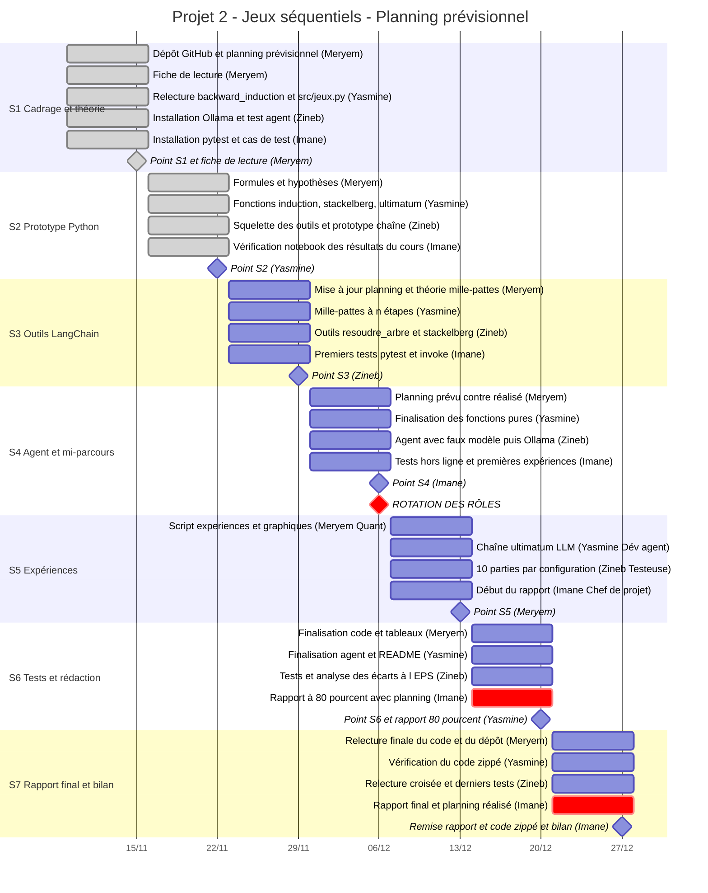

# Gantt prévisionnel – Projet 2 : Jeux séquentiels (Groupe 2)

Version : prévisionnelle (déposée en S1), statuts mis à jour en S2 (19/11/2026). Légende des barres : gris = fait, bleu clair = en cours, bleu = à faire, rouge = jalon critique. La version « réalisée » sera ajoutée en S4 puis en S7, avec l'explication des écarts.

Source éditable : `docs/gantt_source.mmd` · Image : `docs/gantt_previsionnel.png`

## Tâches (responsable, début, fin, durée, statut)

| Sem. | Tâche | Responsable | Début | Fin | Durée | Statut |
|---|---|---|---|---|---|---|
| S1 | Dépôt GitHub et planning prévisionnel | Meryem | 09/11 | 15/11 | 7 j | fait |
| S1 | Fiche de lecture | Meryem | 09/11 | 15/11 | 7 j | fait |
| S1 | Relecture backward_induction et src/jeux.py | Yasmine | 09/11 | 15/11 | 7 j | fait |
| S1 | Installation Ollama et test agent | Zineb | 09/11 | 15/11 | 7 j | fait |
| S1 | Installation pytest et cas de test | Imane | 09/11 | 15/11 | 7 j | fait |
| S2 | Formules et hypothèses | Meryem | 16/11 | 22/11 | 7 j | fait |
| S2 | Fonctions induction, stackelberg, ultimatum | Yasmine | 16/11 | 22/11 | 7 j | fait |
| S2 | Squelette des outils et prototype chaîne | Zineb | 16/11 | 22/11 | 7 j | fait |
| S2 | Vérification notebook des résultats du cours | Imane | 16/11 | 22/11 | 7 j | fait |
| S3 | Mise à jour planning et théorie mille-pattes | Meryem | 23/11 | 29/11 | 7 j | à faire |
| S3 | Mille-pattes à n étapes | Yasmine | 23/11 | 29/11 | 7 j | à faire |
| S3 | Outils resoudre_arbre et stackelberg | Zineb | 23/11 | 29/11 | 7 j | à faire |
| S3 | Premiers tests pytest et invoke | Imane | 23/11 | 29/11 | 7 j | à faire |
| S4 | Planning prévu contre réalisé | Meryem | 30/11 | 06/12 | 7 j | à faire |
| S4 | Finalisation des fonctions pures | Yasmine | 30/11 | 06/12 | 7 j | à faire |
| S4 | Agent avec faux modèle puis Ollama | Zineb | 30/11 | 06/12 | 7 j | à faire |
| S4 | Tests hors ligne et premières expériences | Imane | 30/11 | 06/12 | 7 j | à faire |
| S5 | Script experiences et graphiques | Meryem Quant | 07/12 | 13/12 | 7 j | à faire |
| S5 | Chaîne ultimatum LLM | Yasmine Dév agent | 07/12 | 13/12 | 7 j | à faire |
| S5 | 10 parties par configuration | Zineb Testeuse | 07/12 | 13/12 | 7 j | à faire |
| S5 | Début du rapport | Imane Chef de projet | 07/12 | 13/12 | 7 j | à faire |
| S6 | Finalisation code et tableaux | Meryem | 14/12 | 20/12 | 7 j | à faire |
| S6 | Finalisation agent et README | Yasmine | 14/12 | 20/12 | 7 j | à faire |
| S6 | Tests et analyse des écarts à l EPS | Zineb | 14/12 | 20/12 | 7 j | à faire |
| S6 | Rapport à 80 pourcent avec planning | Imane | 14/12 | 20/12 | 7 j | à faire |
| S7 | Relecture finale du code et du dépôt | Meryem | 21/12 | 27/12 | 7 j | à faire |
| S7 | Vérification du code zippé | Yasmine | 21/12 | 27/12 | 7 j | à faire |
| S7 | Relecture croisée et derniers tests | Zineb | 21/12 | 27/12 | 7 j | à faire |
| S7 | Rapport final et planning réalisé | Imane | 21/12 | 27/12 | 7 j | à faire |

## Rôles et rotation

| Personne | S1 à S4 | S5 à S7 (après rotation) |
|---|---|---|
| Meryem | Chef de projet / Théorie | Quant / Python |
| Yasmine | Quant / Python | Développeur agent |
| Zineb | Développeur agent | Testeur / Expérimentateur |
| Imane | Testeur / Expérimentateur | Chef de projet / Théorie |

## Jalons

| Jalon | Semaine | Date prévue | Responsable | Statut |
|---|---|---|---|---|
| Dépôt GitHub + Gantt prévisionnel | S1 | 15/11 | Meryem | fait |
| Fiche de lecture | S1 | 15/11 | Meryem | fait |
| Point d'avancement S1 | S1 | 15/11 | Meryem | fait |
| Point d'avancement S2 | S2 | 22/11 | Yasmine | en cours |
| Point d'avancement S3 | S3 | 29/11 | Zineb | à faire |
| Point d'avancement S4 + rotation des rôles | S4 | 06/12 | Imane | à faire |
| Point d'avancement S5 | S5 | 13/12 | Meryem | à faire |
| Rapport à 80 % + point S6 | S6 | 20/12 | Imane / Yasmine | à faire |
| Remise rapport + code zippé + bilan S7 | S7 | 27/12 | Imane | à faire |

Légende des statuts : fait / en cours / retard / à faire.
